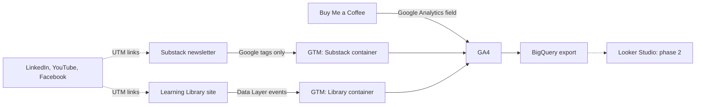
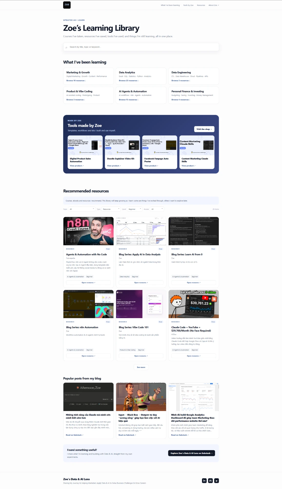
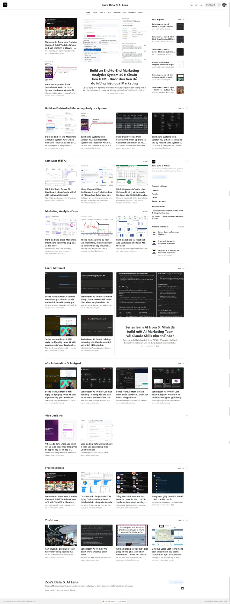
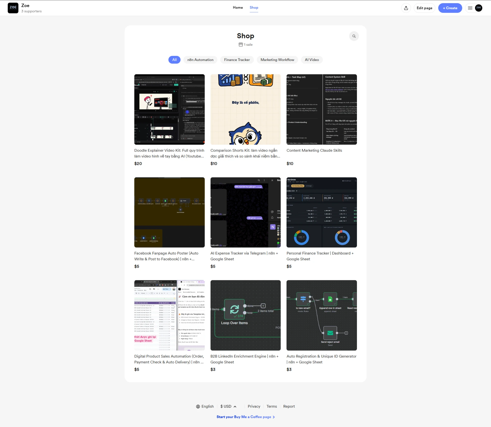
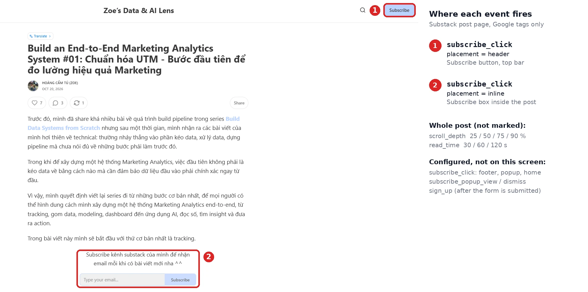
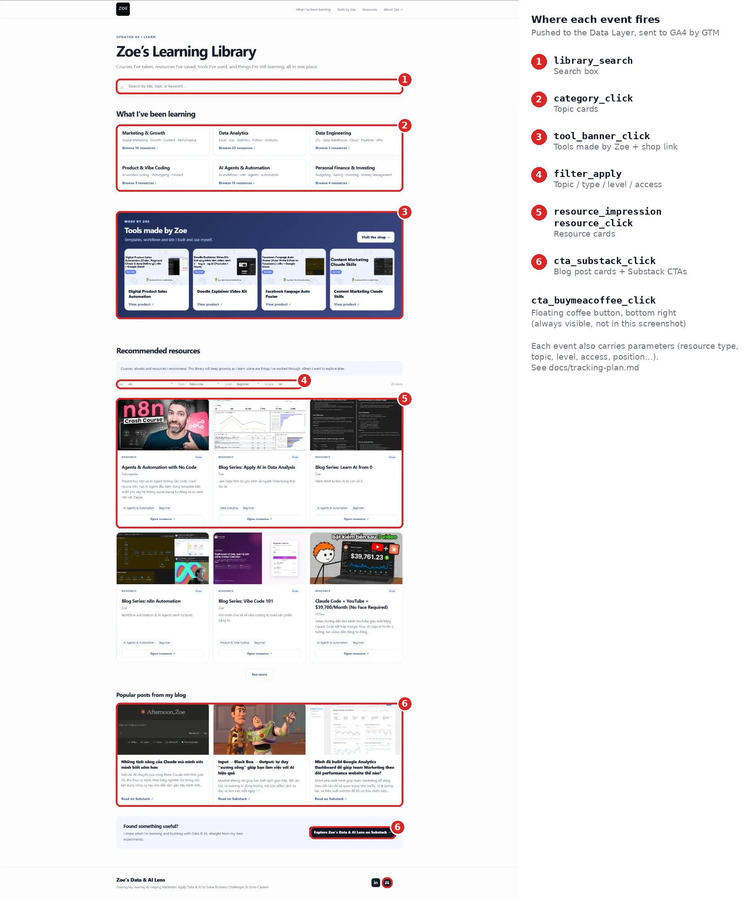
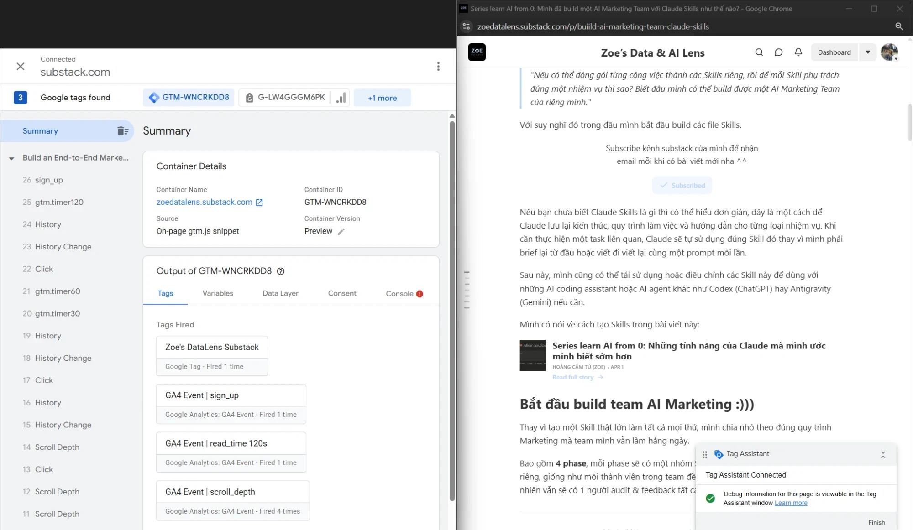

# Multi-Channel Tracking & Behavior Analytics: From Blind Spots to Measurable Conversions

> Tracking built across the channels of a small content ecosystem (a Substack newsletter, a site I control, a Buy Me a Coffee shop and social links), so I can see what visitors do and which sources lead to subscribers. **Tag Manager → GA4 → BigQuery**, with one UTM rule set across every channel.



<table>
  <tr>
    <th align="center"><a href="https://tuhoang3112.github.io/zoe-learning-library/">Learning Library</a></th>
    <th align="center"><a href="https://zoedatalens.substack.com/">Substack newsletter</a></th>
    <th align="center"><a href="https://buymeacoffee.com/zoedatalensai/extras">Buy Me a Coffee</a></th>
  </tr>
  <tr>
    <td valign="top"><a href="https://tuhoang3112.github.io/zoe-learning-library/"></a></td>
    <td valign="top"><a href="https://zoedatalens.substack.com/"></a></td>
    <td valign="top"><a href="https://buymeacoffee.com/zoedatalensai/extras"></a></td>
  </tr>
</table>

<p align="center"><sub>The three properties measured. Substack and Buy Me a Coffee are closed platforms; the Library, a curated collection of courses, ebooks, tools and templates for data, marketing and AI, is the site where I own the code.</sub></p>

---

## Skills shown

Solo project: tracking design, front end, tag management and documentation.

Google Tag Manager (triggers, tags, Data Layer, container import and export) · GA4 (events, key events, custom dimensions, data streams) · UTM taxonomy and channel attribution · JavaScript · HTML and CSS · GitHub Pages and Actions · documentation.

---

## The problem

The ZoeDataLens newsletter on Substack has real traffic, but GA4 could not say what that traffic achieved. **Starting point**, in the 28 days before anything was changed (23 Aug to 19 Sep 2026):

- Tag Manager on Substack held **only the Google tag**: no event tag, no trigger.
- GA4 saw **automatic events only**: page views, one scroll event at 90%, outbound link clicks and typing in forms. Nothing on Subscribe buttons or on signing up.
- **No key event** was set, so conversions were invisible.
- Links I posted on LinkedIn and Facebook carried **no UTM**: the visits show as `linkedin.com / referral` and `l.facebook.com / referral`, and untagged app links fall into `(direct) / (none)`.

| Substack property | Initial state (23 Aug to 19 Sep) | Just before the Substack fix (25 Sep to 22 Oct) | After (23 Oct to 19 Nov) |
|---|---|---|---|
| Sessions | ~2.2K | ~2.4K | to be measured |
| Key events in GA4 | **0** | **0** | to be measured |
| `(direct) / (none)` share of sessions | ~17% | ~12% | to be measured |
| `linkedin.com / referral` share of sessions | ~14% | ~6% | to be measured |

This is the Substack property only: the Library did not exist in the initial window, so it has no "before" (GA4 shows no data for it in that window) and is measured from its launch on 20 Sep, when its standardised UTM links also went live. See the [audit and baseline](docs/tracking-audit.md) for the full tables.

What readers do (GA4) and what they achieve (new subscribers, in Substack's own statistics) lived in two places and could not be joined. A closer look showed this was a configuration gap, not a platform limit: Tag Manager was installed with only the Google tag, so no event tag and no key event existed for subscriptions. Traffic from apps and emails arrived without a source because links carried no UTM.

**Goal:** measure conversions and sources on every channel, inside what each platform allows, and define every event once.
→ [Tracking audit and baseline](docs/tracking-audit.md)

---

## Channels and tracking

| Channel | What was built | Why this way | Not measured |
|---|---|---|---|
| **Substack newsletter** | 12 GA4 event tags: `sign_up`, Subscribe clicks by placement, popup views and dismissals, scroll depth, read time ([container](gtm/substack-container.json)) | Substack runs only Google tags and built-in triggers (GTM Preview shows `allowlist: google`). Custom HTML, custom JavaScript variables and Microsoft Clarity are blocked, so tracking is built within that limit instead of assumed away | Email opens, reading inside the app |
| **Learning Library** | 8 events through the Data Layer: resource impressions and clicks, search, filters, topic clicks, product banner clicks, clicks toward Substack and Buy Me a Coffee ([`analytics.js`](landing-page/js/analytics.js), [container](gtm/library-container.json)) | Substack allows no custom tracking code, so Data Layer events with item attributes (type, topic, level, price, position) needed a site where I own the code | What visitors do after they click through to an outside page (Substack, Buy Me a Coffee, the courses and resources linked): the Library only sees the click |
| **Buy Me a Coffee** | A GA4 data stream in the Library property, connected through the shop's Google Analytics field | It is the only analytics option the platform offers | Purchases in GA4 (they are recorded in Buy Me a Coffee's own dashboard) |
| **LinkedIn, YouTube, Facebook** | One UTM rule set for every link I publish there: `utm_source` (the platform), `utm_medium` (`social` or `video`), `utm_campaign` (the content series) and `utm_content` (where the link sits: caption, bio, description, comment). For example `?utm_source=linkedin&utm_medium=social&utm_campaign=learn-ai-from-0&utm_content=caption-claude-cowork`. Links are built with the [UTM builder](https://tuhoang3112.github.io/zoe-learning-library/tools/utm-builder.html), a web tool I made to standardise UTM values (lowercase, no accents, hyphens) and assemble the link, following the [rules](docs/utm-rules.md) | I do not control the pages these visitors come from, so no tag can run there and the link is the only thing I own. Without UTM, visits from apps and emails land in `(direct) / (none)`, and free-typed names (`LinkedIn`, `linkedin.com`) split one source into several rows. A fixed vocabulary makes one source one row, so GA4 shows which channel and which post brought each visitor | What happens on the platform itself (impressions, reactions, profile views) and anything after the click, which is only seen on the destination site |

---

## Tracking plan

One plan per measured property, all sent to GA4 through Tag Manager.

**Substack newsletter** (6 event types, 12 tags, Google tags and built-in triggers only):

<p align="center"></p>

`subscribe_click` by placement (header, inline, popup, home, footer), `subscribe_popup_view` and `subscribe_popup_dismiss`, `scroll_depth` at 25/50/75/90% and `read_time` at 30/60/120 seconds on posts, plus `sign_up`. Seen firing in GTM Preview: `scroll_depth`, `read_time` and `sign_up` (by a manual push); `subscribe_click` and `sign_up` on a real subscription are still to confirm.

**Learning Library** (8 events through the Data Layer):

<p align="center"></p>

Each event carries the parameters of the resource (type, topic, level, access, provider, position in the catalogue and in the list the visitor sees), so reports can answer which topic, level and price range get clicked, and whether a top-ranked item is clicked only because it is first.

**Buy Me a Coffee** (no events, a connection only): a GA4 data stream was created in the Library property and its Measurement ID pasted into the **Google Analytics** field in the shop's Settings, the only option the platform offers. GA4 receives page views and sources; purchases are recorded in the shop's own dashboard, not in GA4.

<p align="center"></p>

**LinkedIn, YouTube and Facebook** cannot run a tag, so they are tracked only through the UTM on each link: source, medium, campaign and the position of the link, from one fixed vocabulary.

→ [Tracking plan](docs/tracking-plan.md) (events and parameters by property)

---

## Validation

Checked so far in GTM Preview on Substack: the container loads, and `scroll_depth`, `read_time` and `sign_up` (by a manual push) fire. Still to document: `subscribe_click` on a real click, the Library events (Data Layer in Preview) and the events arriving in GA4 (DebugView). The before state is recorded in the [baseline](docs/tracking-audit.md#baseline-before-the-fix); the same 28-day window after the fix will be compared against it. Findings and fixes are in the [tracking audit](docs/tracking-audit.md).

<p align="center"></p>

<p align="center"><sub>GTM Preview (left) on a Substack post (right): the container loads and the Google tag, <code>GA4 Event | sign_up</code>, <code>read_time 120s</code> and <code>scroll_depth</code> (4 times, one per threshold) fire. <code>sign_up</code> was triggered for this test by pushing the event name to the Data Layer from the browser console, not by a real subscription.</sub></p>

---

## Repository structure

```text
.
├── gtm/                  # GTM container exports (Substack, Library) + README
├── landing-page/         # Learning Library site, deployed to GitHub Pages + README
│   ├── js/               #   analytics.js is the single place where events are defined
│   ├── data/             #   resources.json (catalogue) and posts.json (popular posts)
│   └── tools/            #   utm-builder.html: the UTM builder, published with the site
├── scripts/              # build-seo.mjs: sitemap, canonical, structured data
├── .github/workflows/    # deploy.yml: GitHub Pages deploy on push to main
└── docs/
    ├── images/           # screenshots used in the README
    ├── tracking-audit.md # audit and baseline: what was found, the numbers before the fix, what was fixed
    ├── tracking-plan.md  # events and parameters per property: when they fire, what they measure
    └── utm-rules.md      # UTM format, vocabulary, examples
```

Run and deploy notes for the site are in [`landing-page/README.md`](landing-page/README.md). Changes to the Tag Manager containers are published from Tag Manager itself, then re-exported to [`gtm/`](gtm/).

---

## Data privacy

- Figures in this repository are **rounded values and shares** of GA4 reports. No subscriber lists, emails, names or exact Substack statistics.
- No API keys or credentials. GTM and GA4 measurement IDs are public identifiers (they are visible in any page's source).
- No event carries personal data. Search terms are free text, so no field that collects personal data is ever added.

---

## Limits to keep in mind

- Attribution between the sites is aggregate (by day and campaign), never by person: the properties share no user id.
- Email opens and reading inside the Substack app are not measured by GA4.
- Ad blockers and the lack of a consent banner mean counts are a lower bound.
- Buy Me a Coffee only exposes the Google Analytics field: page views and sources reach GA4, purchases do not. Purchases are still recorded in the shop's own dashboard, but they cannot be joined to GA4 sessions.

---

## Status and next steps

Phase 1 (this repository) is the **tracking set-up**: audit, fix, tag management and UTM rules. Phase 2 is the **analysis** on the data these systems collect: funnels, content and source performance, SEO and AI-search visibility, audience survey. It starts once enough data has accumulated.

| Item | State |
|---|---|
| Library tracking (8 events), GTM + GA4 | Live since 2026-09-20 |
| Substack tracking (12 event tags), GTM + GA4 | Live since 2026-10-22 |
| UTM rules and builder | Done, applied to new links |
| Confirm `sign_up` fires on a real subscription | Pending: so far only tested by a manual push |
| Key events marked in GA4 | Done 2026-10-23. Substack: `sign_up`. Library: `cta_substack_click`, `cta_buymeacoffee_click`, `tool_banner_click`, `resource_click` |
| Retag existing content with UTM | Substack menu, sidebar and About page done 2026-10-23; the rest of Substack (old posts, newsletter emails) this week; LinkedIn next week, starting with pinned posts and profile descriptions; old Facebook links are left as they are (too many). Dates are recorded in the audit because retagging affects the "after" window |
| Results: key events and `(direct) / (none)` share, before vs after | Pending: data is accumulating, the same 28-day comparison will be added here |
| Phase 2: analysis, dashboard, SEO / AI-search check, audience survey | Not started |
