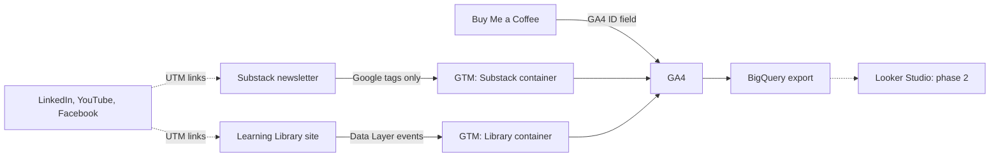

# Multi-Channel Tracking & Behavior Analytics: From Blind Spots to Measurable Conversions

> Tracking built across the channels of a small content ecosystem (a Substack newsletter, a site I control, a Buy Me a Coffee shop and social links), so I can see what visitors do and which sources lead to subscribers. **Tag Manager → GA4 → BigQuery**, with one UTM rule set across every channel.



<table>
  <tr>
    <th align="center"><a href="https://tuhoang3112.github.io/zoe-learning-library/">Learning Library</a></th>
    <th align="center"><a href="https://zoedatalens.substack.com/">Substack newsletter</a></th>
    <th align="center"><a href="https://buymeacoffee.com/zoedatalensai/extras">Buy Me a Coffee</a></th>
  </tr>
  <tr>
    <td valign="top"><a href="https://tuhoang3112.github.io/zoe-learning-library/"></a></td>
    <td valign="top"><a href="https://zoedatalens.substack.com/"></a></td>
    <td valign="top"><a href="https://buymeacoffee.com/zoedatalensai/extras"></a></td>
  </tr>
</table>

<p align="center"><sub>The three properties measured. Substack and Buy Me a Coffee are closed platforms; the Library, a curated collection of courses, ebooks, tools and templates for data, marketing and AI, is the site where I own the code.</sub></p>

*Solo project: analyst and builder (tracking design, front end, tag management, documentation).*

> **Status: phase 1 of 2.** Phase 1 (this repository) is the **tracking set-up**: audit, fix, tag management and UTM rules. Phase 2 is the **analysis** on the data these systems collect (funnels, content and source performance, SEO and AI-search visibility, audience survey). Tracking went live on the Library on 2026-09-20 and on Substack on 2026-10-22, so phase 2 starts once enough data has accumulated.

---

## The problem

The ZoeDataLens newsletter on Substack has real traffic (about 2.2K sessions and 1.2K users in the 28 days before the fix, 23 Aug to 19 Sep 2026) but GA4 could not say what that traffic achieved:

| Baseline (28 days before the fix) | Value |
|---|---|
| Key events in GA4 | **0** |
| `(direct) / (none)` share of sessions | **about 17%**, more than LinkedIn (about 14%): real sources were hidden |
| Sources set by Substack itself (`activity_item`, `confirmation_email`...) | Not UTM-compliant, mixed in with marketing channels |

What readers do (GA4) and what they achieve (new subscribers, in Substack's own statistics) lived in two places and could not be joined. A closer look showed this was a configuration gap, not a platform limit: Tag Manager was installed with only the Google tag, so no event tag and no key event existed for subscriptions. Traffic from apps and emails arrived without a source because links carried no UTM.

**Goal:** measure conversions and sources on every channel, inside what each platform allows, and define every event once.
→ [Baseline](docs/baseline.md)

---

## Channels and tracking

| Channel | What was built | Why this way | Not measured |
|---|---|---|---|
| **Substack newsletter** | 12 GA4 event tags: `sign_up`, Subscribe clicks by placement, popup views and dismissals, scroll depth, read time ([container](gtm/substack-container.json)) | Substack runs only Google tags and built-in triggers (GTM Preview shows `allowlist: google`). Custom HTML, custom JavaScript variables and Microsoft Clarity are blocked, so tracking is built within that limit instead of assumed away | Email opens, reading inside the app |
| **Learning Library** | 8 events through the Data Layer: resource impressions and clicks, search, filters, topic clicks, product banner clicks, clicks toward Substack and Buy Me a Coffee ([`analytics.js`](landing-page/js/analytics.js), [container](gtm/library-container.json)) | Substack allows no custom tracking code, so Data Layer events with item attributes (type, topic, level, price, position) needed a site where I own the code | Whether a visitor who clicks through to Substack subscribes: that happens on Substack, outside the Library's tracking |
| **Buy Me a Coffee** | A GA4 data stream in the Library property, connected through the shop's Google Analytics field | It is the only analytics option the platform offers | Purchases |
| **LinkedIn, YouTube, Facebook** | Source tracking through UTM ([rules](docs/utm-rules.md), [builder](tools/utm-builder.html)) | No tag can run there, and free-typed names (`LinkedIn`, `linkedin.com`) split one source into several rows while untagged app links fall into `(direct) / (none)` | Anything after the click |

**Across all channels**
- **One tag manager:** Google Tag Manager, one container per site, versioned and exported to [`gtm/`](gtm/). Substack has a GTM ID field.
- **One file defines the Library's events** ([`analytics.js`](landing-page/js/analytics.js)), so events and parameters stay consistent and GTM needs one trigger and one tag per event rather than one per resource.
- **UTM with a fixed vocabulary** on every link; links leaving the Library are tagged by code, and a small local tool builds compliant links for the rest.
- **Subscriber counts come from Substack's own statistics.** The Substack and Library properties share no user id, so GA4 is used for behavior and joined to subscribers only by day.
- **GA4 exports to BigQuery** on both properties: a free daily export of raw nested data to write SQL on. It starts from the day it is switched on and cannot be back-filled.

The `sign_up` tag is live and fires in GTM Preview; confirming it on a real subscription and marking it as a key event are the next steps (see Status below).

---

## Tracking plan

One plan per measured property, all sent to GA4 through Tag Manager.

**Substack newsletter** (6 event types, 12 tags, Google tags and built-in triggers only):

<p align="center"></p>

`subscribe_click` by placement (header, inline, popup, home, footer), `subscribe_popup_view` and `subscribe_popup_dismiss`, `scroll_depth` at 25/50/75/90% and `read_time` at 30/60/120 seconds on posts, plus `sign_up`. Seen firing in GTM Preview: `scroll_depth`, `read_time` and `sign_up` (by a manual push); `subscribe_click` and `sign_up` on a real subscription are still to confirm.

**Learning Library** (8 events through the Data Layer):

<p align="center"></p>

Each event carries the parameters of the resource (type, topic, level, access, provider, position in the catalogue and in the list the visitor sees), so reports can answer which topic, level and price range get clicked, and whether a top-ranked item is clicked only because it is first.

**Buy Me a Coffee** (no events, a connection only): a GA4 data stream was created in the Library property and its Measurement ID pasted into the **Google Analytics** field in the shop's Settings, the only option the platform offers. GA4 receives page views and sources, not purchases.

<p align="center"></p>

**LinkedIn, YouTube and Facebook** cannot run a tag, so they are tracked only through the UTM on each link.

→ [Tracking plan](docs/tracking-plan.md) (events by property) · [Data dictionary](docs/data-dictionary.md) (parameters)

---

## Validation

Each implementation is checked in GTM Preview and the data checked in GA4 reports. The before state is recorded in the [baseline](docs/baseline.md); the same 28-day window after the fix will be compared against it. Findings and fixes are in the [tracking audit](docs/tracking-audit.md).

<p align="center"></p>

<p align="center"><sub>GTM Preview (left) on a Substack post (right): the container loads and the Google tag, <code>GA4 Event | sign_up</code>, <code>read_time 120s</code> and <code>scroll_depth</code> (4 times, one per threshold) fire. <code>sign_up</code> was triggered for this test by pushing the event name to the Data Layer from the browser console, not by a real subscription.</sub></p>

---

## Status and next steps

| Item | State |
|---|---|
| Library tracking (8 events), GTM + GA4 | Live since 2026-09-20 |
| Substack tracking (12 event tags), GTM + GA4 | Live since 2026-10-22 |
| UTM rules and builder | Done, applied to new links |
| Confirm `sign_up` fires on a real subscription | Pending: so far only tested by a manual push |
| Mark `sign_up` as a GA4 key event | Pending: it must appear in GA4 first |
| Results: key events and `(direct) / (none)` share, before vs after | Pending: data is accumulating, the same 28-day comparison will be added here |
| Phase 2: analysis, dashboard, SEO / AI-search check, audience survey | Not started |

---

## Skills shown

Google Tag Manager (triggers, tags, Data Layer, container import and export) · GA4 (events, key events, custom dimensions, data streams) · UTM taxonomy and channel attribution · JavaScript · HTML and CSS · GitHub Pages and Actions · documentation.

---

## Repository structure

```text
.
├── gtm/                  # GTM container exports (Substack, Library) + README
├── landing-page/         # Learning Library site, deployed to GitHub Pages + README
│   ├── js/               #   analytics.js is the single place where events are defined
│   └── data/             #   resources.json (catalogue) and posts.json (popular posts)
├── tools/                # UTM builder
├── scripts/              # build-seo.mjs: sitemap, canonical, structured data
├── .github/workflows/    # deploy.yml: GitHub Pages deploy on push to main
└── docs/
    ├── images/           # screenshots used in the README
    ├── baseline.md       # GA4 baseline before the Substack fix
    ├── tracking-audit.md # what the audit found and what was fixed
    ├── tracking-plan.md  # Library events: when they fire, what they measure
    ├── data-dictionary.md# event parameters
    └── utm-rules.md      # UTM format, vocabulary, examples
```

Run and deploy notes for the site are in [`landing-page/README.md`](landing-page/README.md). Changes to the Tag Manager containers are published from Tag Manager itself, then re-exported to [`gtm/`](gtm/).

---

## Data privacy

- Figures in this repository are **rounded values and shares** of GA4 reports. No subscriber lists, emails, names or exact Substack statistics.
- No API keys or credentials. GTM and GA4 measurement IDs are public identifiers (they are visible in any page's source).
- No event carries personal data. Search terms are free text, so no field that collects personal data is ever added.

---

## Limits to keep in mind

- Attribution between the sites is aggregate (by day and campaign), never by person: the properties share no user id.
- Email opens and reading inside the Substack app are not measured by GA4.
- Ad blockers and the lack of a consent banner mean counts are a lower bound.
- Buy Me a Coffee only exposes the Google Analytics field: page views and sources are measured, purchases are not.
