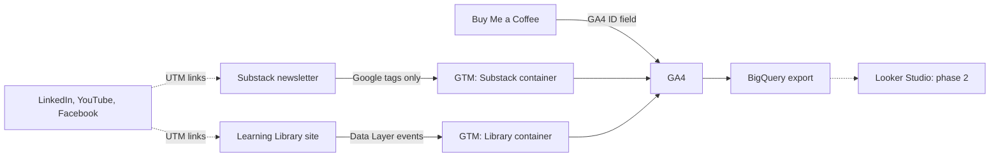

# Multi-Channel Tracking & Behavior Analytics: From Blind Spots to Measurable Conversions

> Tracking built across the channels of a small content ecosystem (a Substack newsletter, a site I control, a Buy Me a Coffee shop and social links), so I can see what visitors do and which sources lead to subscribers. **Tag Manager → GA4 → BigQuery**, with one UTM rule set across every channel.



**The site being measured:** <https://tuhoang3112.github.io/zoe-learning-library/> (Zoe's Learning Library, a curated library of courses, ebooks, tools and templates for data, marketing and AI).

*Solo project: analyst and builder (tracking design, front end, tag management, documentation).*

> **Status: phase 1 of 2.** Phase 1 (this repository) is the **tracking set-up**: audit, fix, tag management and UTM rules. Phase 2 is the **analysis** on the data these systems collect (funnels, content and source performance, SEO and AI-search visibility, audience survey). Tracking went live on the Library on 2026-09-20 and on Substack on 2026-10-22, so phase 2 starts once enough data has accumulated.

---

## The problem

The ZoeDataLens newsletter on Substack has real traffic (about 2.2K sessions and 1.2K users in the 28 days before the fix, 23 Aug to 19 Sep 2026) but GA4 could not say what that traffic achieved:

| Baseline (28 days before the fix) | Value |
|---|---|
| Key events in GA4 | **0** |
| `(direct) / (none)` share of sessions | **about 17%**, more than LinkedIn (about 14%): real sources were hidden |
| Sources set by Substack itself (`activity_item`, `confirmation_email`...) | Not UTM-compliant, mixed in with marketing channels |

What readers do (GA4) and what they achieve (new subscribers, in Substack's own statistics) lived in two places and could not be joined. A closer look showed this was a configuration gap, not a platform limit: Substack already pushes a `sign_up` event, but no tag sent it to GA4. Traffic from apps and emails arrived without a source because links carried no UTM.

**Goal:** measure conversions and sources on every channel, inside what each platform allows, and define every event once.
→ [Baseline](docs/baseline.md)

---

## Architecture decisions

| Decision | Choice | Why |
|---|---|---|
| **Tag management** | **Google Tag Manager** | One place for every tag on a site, versioned and exportable. Substack has a GTM ID field |
| **Substack** | **Google tags and built-in triggers only** | Substack runs only Google tags (GTM Preview shows `allowlist: google`). Custom HTML, custom JavaScript variables and Microsoft Clarity are blocked, so tracking is built within that limit instead of assumed away |
| **A site I control** | **Learning Library**, plain HTML and JS | Substack allows no custom tracking code, so Data Layer events with item attributes (type, topic, level, price, position) needed a site where I own the code |
| **Event design** | **One file defines every event** ([`analytics.js`](landing-page/js/analytics.js)) | Events and parameters stay consistent, and GTM needs one trigger and one tag per event rather than one per resource |
| **Attribution** | **UTM with a fixed vocabulary** | Free-typed names (`LinkedIn`, `linkedin.com`) split one source into several rows, and untagged app links fall into `(direct) / (none)` |
| **Subscriber counts** | **Substack's own statistics are the source of truth** | The Substack and Library properties share no user id, so GA4 is used for behavior and joined to subscribers only by day |
| **Raw data** | **GA4 export to BigQuery**, both properties | Free daily export, and raw nested data to write SQL on. It starts from the day it is switched on and cannot be back-filled |

---

## Channels and tracking

| Channel | What was built | How | In the repo | Not measured |
|---|---|---|---|---|
| **Substack newsletter** | 12 GA4 event tags: `sign_up`, Subscribe clicks by placement, popup views and dismissals, scroll depth, read time | Google tags and built-in triggers | [`gtm/substack-container.json`](gtm/substack-container.json) | Email opens, reading inside the app |
| **Learning Library** | 8 events through the Data Layer: resource impressions and clicks, search, filters, topic clicks, product banner clicks, clicks toward Substack and Buy Me a Coffee | Custom code, all in one file | [`analytics.js`](landing-page/js/analytics.js), [`gtm/library-container.json`](gtm/library-container.json) | What happens inside the embedded Substack form |
| **Buy Me a Coffee** | A GA4 stream inside the Library property | Only the platform's Google Analytics ID field is available | Platform setting | Purchases |
| **LinkedIn, YouTube, Facebook** | Source tracking through UTM, no tag possible | Fixed vocabulary of source, medium, campaign, content | [`docs/utm-rules.md`](docs/utm-rules.md), [`tools/utm-builder.html`](tools/utm-builder.html) | Anything after the click |

`sign_up` now reaches GA4; marking it as a key event is the next step (see Status below). Links leaving the Library are tagged with UTM by code; a small local tool builds compliant links for everything else.

---

## Tracking plan

The Library's 8 events, with the parameters each carries (resource type, topic, level, access, provider, position in the catalogue and in the list the visitor sees), so reports can answer which topic, level and price range get clicked, and whether a top-ranked item is clicked only because it is first.

→ [Tracking plan](docs/tracking-plan.md) (events) · [Data dictionary](docs/data-dictionary.md) (parameters)

---

## Validation

Each implementation is checked in GTM Preview and the data checked in GA4 reports. The before state is recorded in the [baseline](docs/baseline.md); the same 28-day window after the fix will be compared against it. Findings and fixes are in the [tracking audit](docs/tracking-audit.md).

---

## Status and next steps

| Item | State |
|---|---|
| Library tracking (8 events), GTM + GA4 | Live since 2026-09-20 |
| Substack tracking (12 event tags), GTM + GA4 | Live since 2026-10-22 |
| UTM rules and builder | Done, applied to new links |
| Mark `sign_up` as a GA4 key event | Pending: it must appear in GA4 first |
| Results: key events and `(direct) / (none)` share, before vs after | Pending: data is accumulating, the same 28-day comparison will be added here |
| Phase 2: analysis, dashboard, SEO / AI-search check, audience survey | Not started |

---

## Skills shown

Google Tag Manager (triggers, tags, Data Layer, container import and export) · GA4 (events, key events, custom dimensions, data streams) · UTM taxonomy and channel attribution · JavaScript · HTML and CSS · GitHub Pages and Actions · documentation.

---

## Repository structure

```text
.
├── gtm/                  # GTM container exports (Substack, Library) + README
├── landing-page/         # Learning Library site, deployed to GitHub Pages + README
│   ├── js/               #   analytics.js is the single place where events are defined
│   └── data/             #   resources.json (catalogue) and posts.json (popular posts)
├── tools/                # UTM builder
├── scripts/              # build-seo.mjs: sitemap, canonical, structured data
├── .github/workflows/    # deploy.yml: GitHub Pages deploy on push to main
└── docs/
    ├── baseline.md       # GA4 baseline before the Substack fix
    ├── tracking-audit.md # what the audit found and what was fixed
    ├── tracking-plan.md  # Library events: when they fire, what they measure
    ├── data-dictionary.md# event parameters
    └── utm-rules.md      # UTM format, vocabulary, examples
```

Run and deploy notes for the site are in [`landing-page/README.md`](landing-page/README.md). Changes to the Tag Manager containers are published from Tag Manager itself, then re-exported to [`gtm/`](gtm/).

---

## Data privacy

- Figures in this repository are **rounded values and shares** of GA4 reports. No subscriber lists, emails, names or exact Substack statistics.
- No API keys or credentials. GTM and GA4 measurement IDs are public identifiers (they are visible in any page's source).
- No event carries personal data. Search terms are free text, so no field that collects personal data is ever added.

---

## Limits to keep in mind

- Attribution between the sites is aggregate (by day and campaign), never by person: the properties share no user id.
- Email opens and reading inside the Substack app are not measured by GA4.
- Ad blockers and the lack of a consent banner mean counts are a lower bound.
- Buy Me a Coffee only exposes the Google Analytics ID field: page views and sources are measured, purchases are not.
