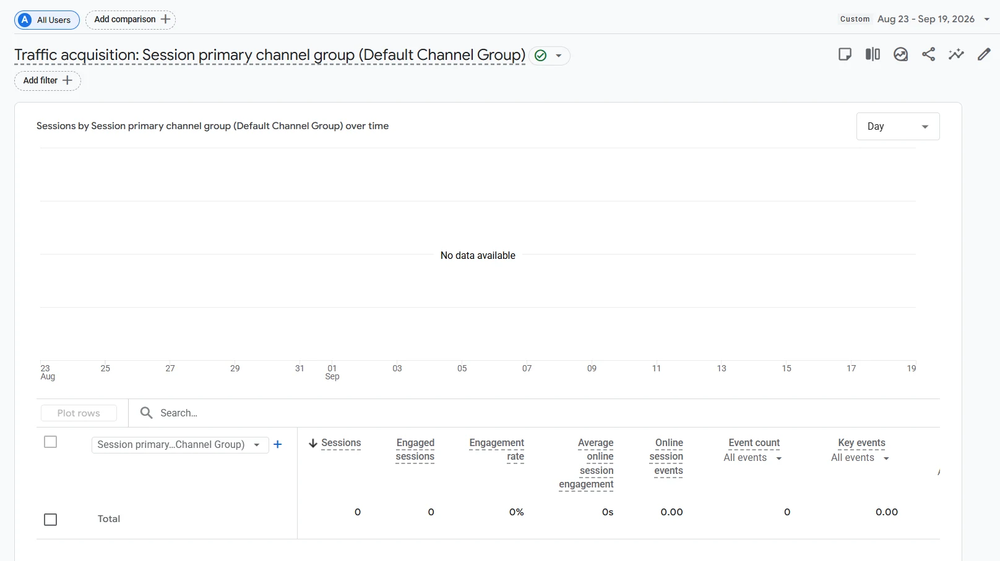
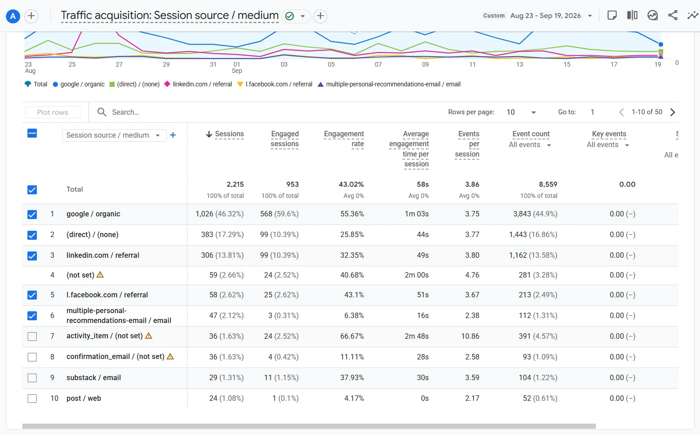

# Tracking audit and baseline: Substack and Learning Library

What could and could not be measured on the two sites, how the newsletter looked in GA4 **before** the fix, and what was done about it. Audit date: 2026-09-20, using GA4 reports, Tag Manager Preview and Substack's settings. What was built is in [`tracking-plan.md`](tracking-plan.md).

## The main finding

GA4 on the newsletter showed **0 key events**. The cause was **configuration, not the platform**:

- Tag Manager was installed with **only the Google tag** (the one that connects the site to GA4). No trigger, no event tag and no other configuration existed, so GA4 collected only its automatic events (page views, enhanced measurement). That is the starting point, not a fault: everything beyond it was built in the fix.
- No tag, trigger or key event existed for subscriptions, so conversions were invisible. The `sign_up` event was set up in the fix (a Custom Event trigger and a GA4 Event tag); it was first tested by pushing the event name from the browser console, then confirmed with real subscriptions on 2026-10-23 (see the problems table: Substack sends it twice per subscription).
- About one session in six had no known source: `(direct) / (none)` was ~17% of sessions in the initial window, and `(direct) / (none)` with `(not set)` ~16% in the next one.

## What Substack allows

Tag Manager on Substack only runs **Google tags and built-in triggers** (click, scroll depth, timer, element visibility, custom event). Custom HTML, custom JavaScript variables and non-Google pixels (including Microsoft Clarity) are blocked. Custom tracking therefore had to be built around that list.

## Baseline before the fix

Two windows of 28 days, both from the GA4 reports of the Substack property. Figures are rounded; shares are of total sessions.

- **Initial state: 23 Aug to 19 Sep 2026.** Before anything was changed: Substack had only the Google tag, and the Library did not exist yet (it went live on 20 Sep with its standardised UTM links), so this baseline is Substack only.
- **Just before the Substack fix: 25 Sep to 22 Oct 2026.** The Library's UTM links were already running; Substack event tracking went live on 22 Oct. This window is the fair "before" for the Substack fix alone, because the Library's UTM links are present in it and in the "after" window.

The Learning Library property has nothing to compare against: GA4 shows no data for it in the initial window.

GA4 Traffic acquisition by channel group, Learning Library property, 23 Aug to 19 Sep 2026: 0 sessions, 0 events and "No data available".

| Metric | Initial state (23 Aug to 19 Sep) | Just before the fix (25 Sep to 22 Oct) |
|---|---|---|
| Active users | ~1.2K | not captured |
| Sessions | ~2.2K | ~2.4K |
| Engagement rate | ~43% | ~45% |
| Average engagement time per session | ~1 min | ~1 min |
| Key events | **0** | **0** |

**Where sessions came from**

| Source / medium | Initial state | Just before the fix | Note |
|---|---|---|---|
| `google / organic` | ~46% | ~51% | The main channel, larger than every other source |
| `(direct) / (none)` | ~17% | ~12% | Hidden sources: untagged links from apps and emails land here |
| `linkedin.com / referral` | ~14% | ~6% | Link without UTM |
| `ActiveCampaign / email` | not listed | ~6% | Email tool, tagged by the tool itself |
| `(not set)` | ~3% | ~5% | No source recorded |
| `l.facebook.com / referral` | ~3% | ~5% | Link without UTM |
| `multiple-personal-recommendations-email / email` | ~2% | not listed | Set by Substack |
| `activity_item / (not set)` | ~2% | not listed | Set by Substack, cannot be renamed |
| `confirmation_email / (not set)` | ~2% | not listed | Set by Substack, cannot be renamed |
| `coccoc.com / referral` | not listed | ~2% | Cốc Cốc, a Vietnamese search engine that GA4 counts as referral |
| `learning-library / referral` | none (the Library was not live) | ~2% | UTM added by the Library's own code |
| `facebook.com / referral` | not listed | ~2% | Link without UTM |
| `substack / email` | ~1% | ~1% | |
| `post / web` | ~1% | not listed | |
| Other sources | ~10% | ~9% | |

GA4 Traffic acquisition by session source / medium, Substack property, 23 Aug to 19 Sep 2026: the initial state, before anything was changed. The Key events column is 0 for every source.

"Not listed" means the source was not among the rows read for that window, not that it had no sessions.

**What GA4 recorded as events** (automatic events only, initial state: 23 Aug to 19 Sep, to be refreshed for 25 Sep to 22 Oct)

| Event | Count (rounded) | What it can tell | What it cannot tell |
|---|---|---|---|
| `page_view` | ~3.1K | Which pages were viewed | |
| `scroll` | ~580 | That someone reached the bottom of a page | Fires once at 90%, so no view of where readers stop |
| `click` | ~140 | Outbound link clicks | Subscribe buttons and other on-site clicks |
| `form_start` | ~30 | That someone started typing in a form | Whether they actually signed up |
| `sign_up` | none | Nothing: not configured yet | No tag or trigger existed for it, so subscriptions were not recorded |

## Problems found and fixes

| Problem | Effect | Fix |
|---|---|---|
| No event for subscriptions, no key event | Subscriptions invisible in GA4 | `sign_up` tag added and marked as a key event on 2026-10-23 (confirmed with real subscriptions on 2026-10-23) |
| `sign_up` is sent twice for one real subscription (found on 2026-10-23): Substack pushes it on the page where the form is submitted and again on the page that loads a few seconds later (the steps shown after subscribing). Both events carry the same `ga_session_id` | The event count and the Key events column are doubled | One signup is counted per session, not per event: use the session key event rate in GA4, or count distinct `user_pseudo_id` and `ga_session_id` in BigQuery. It cannot be filtered when the tag fires, because Substack blocks custom code and GTM cannot remember what it already sent |
| `scroll` fires only at 90% | Cannot see where readers drop off | Custom `scroll_depth` at 25, 50, 75, 90% |
| `click` only covers outbound links | Subscribe buttons not measured | `subscribe_click` per placement (header, popup, inline, footer, home) |
| `form_start` is typing, not signing up | Counts intent, not conversion | `sign_up` is the conversion |
| Links from apps and emails have no source | Inflated `(direct) / (none)` | UTM rules for every link ([`utm-rules.md`](utm-rules.md)) |
| Sources set by Substack itself (`activity_item`, `confirmation_email`...) | Cannot be renamed | Read them as "Substack internal", not as marketing channels |

Supporting setup: GA4 data export to BigQuery on both properties, custom dimensions for the event parameters, and Search Console verified on both sites.

## How the "after" will be measured

Same property, a **28-day window that starts after the fix** (Substack tracking live since 2026-10-22; the window starts the day after, 23 Oct to 19 Nov), same metrics:

1. Key events: from 0 to the count of `sign_up`, marked as a key event on 2026-10-23 (`subscribe_click` is not a key event yet). The Library property has no "before": its key events (`cta_substack_click`, `cta_buymeacoffee_click`, `tool_banner_click`, `resource_click`) count from the same day.
2. Share of `(direct) / (none)`: ~17% in the initial state (23 Aug to 19 Sep) and ~12% just before the fix (25 Sep to 22 Oct); after = to be measured over 23 Oct to 19 Nov.
3. Behaviour: scroll depth at 25/50/75/90% and read time instead of a single 90% scroll.

**Retagging existing content (Substack and LinkedIn).** Retagging old links lowers the `(direct) / (none)` share on its own, so the "after" figure has to be read together with these dates:

| Part | Planned | Retagged on |
|---|---|---|
| Navigation menu | this week | 2026-10-23 |
| Sidebar | this week | 2026-10-23 |
| About page | this week | 2026-10-23 |
| Newsletter emails | this week | not yet |
| Old Substack posts | this week | in progress (there are many, so they are done gradually) |
| LinkedIn pinned posts | next week (26 Oct to 1 Nov), first | not yet |
| LinkedIn profile descriptions | next week, second | not yet |
| LinkedIn other posts and comments | next week, after the first two | not yet |
| Facebook posts and comments | not planned: too many, old links stay untagged | not applicable |

## Limits

- Different 28-day windows differ in posting schedule and seasonality, so the comparison shows direction, not exact causal effect.
- The two properties share no user id, so the sites are linked by campaign name and by day, never by person.
- Substack's own statistics (subscribers by source and post) stay the source of truth for subscriber counts; GA4 is used for behaviour. Email opens and reading inside the Substack app are not measured by GA4.
- Old Facebook links are not retagged, so `l.facebook.com / referral` keeps receiving visits from them and will not fall to zero.
- Ad blockers and the lack of a consent banner mean GA4 counts are a lower bound.
