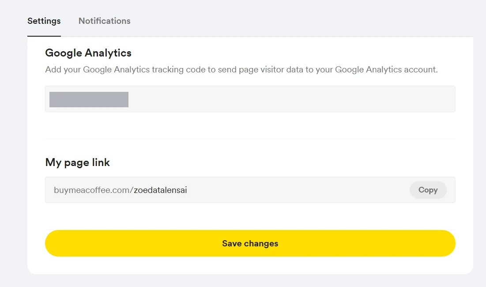

# Tracking plan

One plan per measured property. Every event is sent to GA4 by Google Tag Manager; GA4's automatic `page_view` stays on everywhere. Parameters are described in [`data-dictionary.md`](data-dictionary.md).

| Property | How it is tracked | Events |
|---|---|---|
| [Substack newsletter](#substack-newsletter) | Google tags and built-in triggers only (the platform blocks custom code) | 6 event types, 12 tags |
| [Learning Library](#learning-library) | Events pushed to the Data Layer by the site's own code | 8 |
| [Buy Me a Coffee](#buy-me-a-coffee) | A GA4 data stream connected through the platform's Google Analytics field | none (page views and sources only) |
| [LinkedIn, YouTube, Facebook](#linkedin-youtube-and-facebook) | UTM on every link | none (no tag possible) |

## Substack newsletter

Container: [`gtm/substack-container.json`](../gtm/substack-container.json). Click, scroll, timer and element-visibility triggers are built in, so no custom code is needed.

| Event | Fires when | Parameter | What it tells me |
|---|---|---|---|
| `subscribe_click` | A button with the text "Subscribe" is clicked | `subscribe_location` = `header` (top menu), `inline` (box inside a post), `popup`, `home` (home page), `footer` (band at the bottom) | Which placement gets clicked |
| `subscribe_popup_view` | The subscribe dialog is at least 50% visible (once) | `subscribe_location` = `popup` | How often the popup is shown |
| `subscribe_popup_dismiss` | A button in the dialog other than Subscribe is clicked | `subscribe_location` = `popup` | How often it is closed without subscribing |
| `scroll_depth` | A post page (`/p/`) reaches 25, 50, 75 and 90% | `percent_scrolled` | Where readers stop reading |
| `read_time` | A post page has been open for 30, 60 and 120 seconds (once each) | `read_seconds` | How long posts keep readers. It measures time on the page, not active reading |
| `sign_up` | A `sign_up` event appears in the Data Layer | none | Subscriptions: the conversion |

**Status.** Seen firing in GTM Preview: `scroll_depth`, `read_time` and `sign_up` (the last one by a manual push). Still to confirm: `subscribe_click` on a real click (Preview shows errors for the `Click Text` variable these triggers use) and `sign_up` on a real subscription. See [`tracking-audit.md`](tracking-audit.md).

## Learning Library

What the Library measures, when each event fires and why it matters. Every event is pushed to the Data Layer by [`landing-page/js/analytics.js`](../landing-page/js/analytics.js) and sent to GA4 by Tag Manager. GA4's automatic `page_view` stays on.

| Event | Fires when | What it tells me |
|---|---|---|
| `resource_impression` | A resource card is at least 50% visible (once per card and position, never while the tab is hidden) | How many people saw each resource: the base for click-through rate |
| `resource_click` | A resource title or "Open resource" is clicked | Which resources people open |
| `library_search` | Someone searches (after a pause, or on submit) | What people look for, and what they do not find (`result_count = 0`) |
| `filter_apply` | A filter changes | Which filters and combinations are used |
| `category_click` | A topic card is clicked | Which topics attract interest |
| `tool_banner_click` | A product or "Visit the shop" is clicked in the "Tools made by Zoe" banner | Interest in my own products, apart from the library list |
| `cta_substack_click` | Any link toward Substack is clicked (header, banner, resource card, post card, About, footer) | The main goal: visitors moving to the newsletter |
| `cta_buymeacoffee_click` | The coffee-cup donate button is clicked | Interest in supporting the project |

**Parameters.** Resource events carry `resource_id`, `resource_name`, `resource_type`, `topic`, `level`, `access`, `provider` and `position`. `cta_*` events carry `cta_location` (where the link was). Search and filter events carry the term or filters plus `result_count`.

**Two position fields.** `position` is a resource's fixed place in the catalogue. `list_position` is its place in the list the visitor is actually looking at (after search and filters). Click-through rate by position = `resource_click` ÷ `resource_impression`, grouped by `list_position`. The catalogue order is fixed, so position and resource are partly mixed up; search and filters add some natural variation, and a clean test would need shuffled order.

**Set-up in Tag Manager.** One Custom Event trigger and one GA4 Event tag per event, with Data Layer Variables for the parameters (no tag per resource). The parameters used in reports are registered as GA4 custom dimensions, and `result_count` as a custom metric.

**Privacy.** No emails, names or other personal data in any event. Search terms are free text, so no field that collects personal data is ever added.

Links the site sends to Substack and Buy Me a Coffee carry UTM parameters, see [`utm-rules.md`](utm-rules.md).

## Buy Me a Coffee

Buy Me a Coffee runs no tag manager and no custom code, and the only analytics option it offers is a Google Analytics field. So there is no event plan here, only a connection:

| Step | What was done |
|---|---|
| 1. Stream | A web data stream for the shop was created in the Library's GA4 property |
| 2. Connect | The stream's Measurement ID (`G-...`) was pasted into the **Google Analytics** field in the shop's **Settings** tab, then saved |
| 3. Result | GA4 receives page views and traffic sources for the shop pages, with no tag in between |

| Measured | Not measured |
|---|---|
| Page views, traffic sources (including the UTM links that point to the shop) | Purchases and anything inside the checkout, because the platform exposes nothing beyond the ID field |

Clicks from the Library to the shop are counted on the Library side as `cta_buymeacoffee_click` (donate button) and `tool_banner_click` (product links), and those links carry UTM (`utm_source=learning-library`, `utm_medium=referral`). See [`utm-rules.md`](utm-rules.md).

## LinkedIn, YouTube and Facebook

These channels cannot run a tag, so the only tracking is the source written on each link: see [`utm-rules.md`](utm-rules.md).
